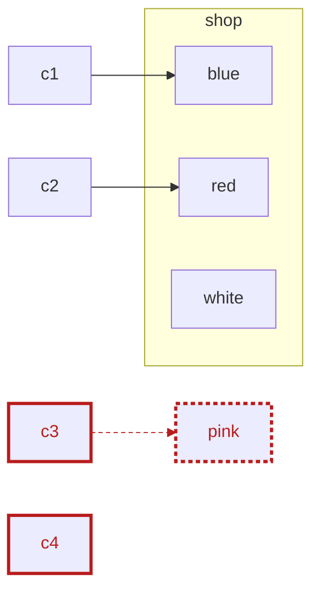
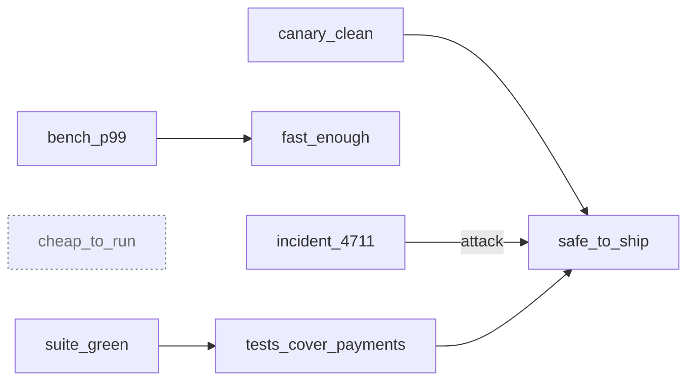
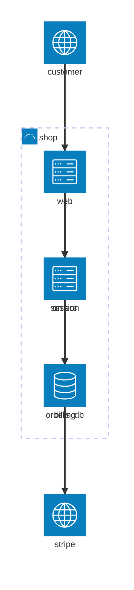
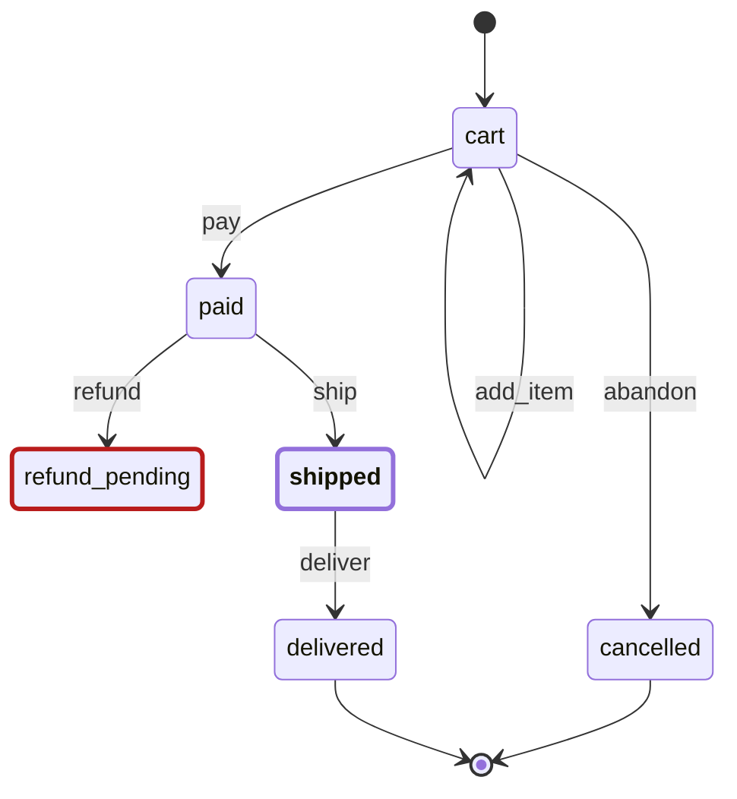
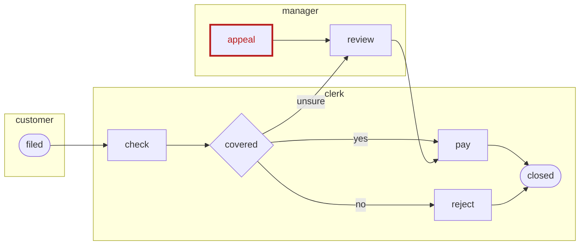
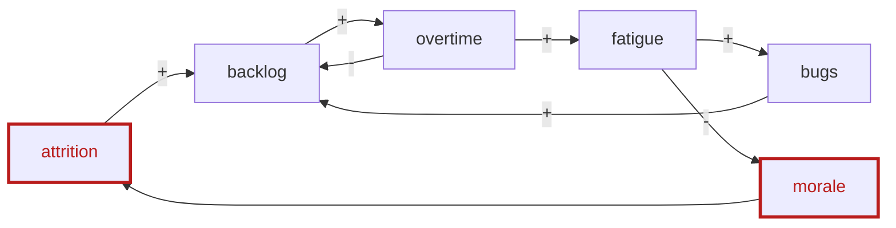
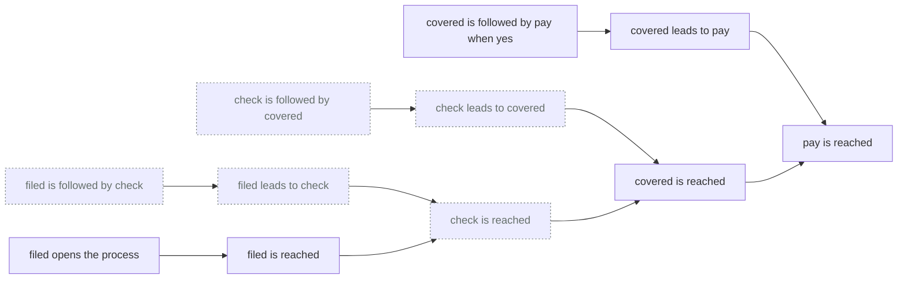

# Рисование

Строка `draw K` в ячейке рисует то, к чему пришёл блокнот, как картинку вида
`K`. Картинка состоит из фактов, так что её можно проверять, как любые
другие. `never` над ней — инвариант, `why` на метке — доказательство, а
`excise` перед `draw` показывает, что меняет один факт.

Каждая картинка на этой странице порождена `npm run guide` из примера,
который она называет, и `npm run guide -- --check` падает, если какая-то
устарела. На [опубликованном руководстве](https://disentinel.github.io/rofl/guide/ru/DRAWING.html)
каждая картинка рисуется живьём теми же модулями, которыми рисует VS Code:
щёлкните группу, чтобы открыть или закрыть её, метку — чтобы увидеть её
факты, и *Full screen* — чтобы увидеть картинку целиком. На GitHub, где
скрипты не выполняются, страница показывает SVG рендерера там, где он его
рисует, а для видов-графов, которым для раскладки нужен браузер, — их
mermaid, который GitHub рисует сам.

## Как рисует блокнот

1. **Прочтите словарь вида.** Он перечисляет слова, из которых состоит
   картинка: `visual/graph.rofl.md` (метка, связь, группа),
   `visual/time.rofl.md` (дорожка, интервал, сообщение),
   `visual/table.rofl.md` (строка, столбец, значение), `visual/space.rofl.md`
   (точка, прямоугольник, ось) и `visual/notation.rofl.md` (человек,
   рождение, семья). Они поставляются вместе с ROFL, так что блокнот называет
   словарь без пути: `reads: [rofl:visual/graph.rofl.md]`.
2. **Скажите правилами, что такое метка.** Например, «машина X — узел, если
   X на линии» или «X связан с Y, если X надо покрасить в Y». Эти правила —
   адаптер от вашей предметной области к картинке.
3. **Попросите её.** `draw graph`, `draw time`, `draw table`, `draw space` и
   `draw notation` рисуют пять семейств. У каждого диалекта и каждой формы
   ниже есть собственное имя.

В VS Code картинка рисуется под ячейкой. В командной строке
`rofl-nb F.rofl.md` печатает её счётчики и её текст: mermaid, DOT, Argdown,
Vega-Lite, GeoJSON, таблицу Markdown или GEDCOM. Добавьте `--format F`,
чтобы выбрать одну из этих форм, и `--json`, чтобы получить вид вместе с его
происхождением.

## Что несёт каждая картинка

- **Статус.** Рендерер сам помечает метку тегами; эти теги зарезервированы,
  и адаптер не может их записать:
  - `failing`: какой-то `never` в блокноте её называет.
  - `dangling`: связь не указывает ни на какую метку.
  - `unknown`: правила разбора (inquiry) говорят, что этого никто не знает.
  - `blind`: она пришла из файла, который модель не смогла прочесть.
  - `gone` и `new`: `excise` в ячейке её убрал или добавил.
- **Почему.** Щёлкните метку в VS Code: факты, на которых она стоит,
  произносятся предложениями, на один шаг доказательства вниз.
- **Что, если.** `excise F`, а затем `draw K` в одной ячейке рисуют картинку
  после изъятия. Что изъятие отняло, помечено `gone`, а что оно пропустило —
  `new`.
- **Кадры.** `frame(M, F)` помещает метку в кадр `F`. Картинка становится
  серией малых картинок, по одной на кадр по порядку, и каждый кадр
  сравнивается с предыдущим.
- **Масштаб.** `collapsed(G)` сворачивает группу в одну метку с подписью,
  сколько меток в ней, а щелчок снова её раскрывает. Что считается группой,
  зависит от вида:
  - граф: то, что `inside` неё;
  - временная шкала: дорожки в `lane_group`;
  - доказательство: факты под фактом.
- **Закрепить раскладку.** В VS Code картинку графа можно закрепить: факты
  `placed(M, X, Y)` записываются рядом с блокнотом, и блокнот, который их
  читает, рисует каждую метку на том же месте.

## Граф

Метка и связи между метками, в VS Code нарисованные как схема: группы — это
рамки, которые открываются и закрываются, заметка указывает на метку яркой
стрелкой, связь несёт маленькую таблицу своих термов, а рамка раскладывает
свои метки слоями, дорожками, матрицей, временной шкалой, квадрантом и так
далее ([docs/schemas.md](../../docs/schemas.md)). Какая картинка отвечает на
какой вопрос — в книге
[`visual/viewpoints.rofl.md`](../../visual/viewpoints.rofl.md). Каждый
диалект — это словарь графа плюс теги, которым диалект даёт значение и вид.

### graph

[`paint-shop.rofl.md`](../../examples/visual/paint-shop.rofl.md): машины на
линии, стрелка к цвету, в который каждую надо покрасить. Машины, которые
уходят некрашеными, проваливают `never`; стрелка `c3` указывает на цвет,
которого в цехе нет, и потому повисает.

<!-- BEGIN draw examples/visual: paint-shop.rofl.md -->
<!-- view ../pictures/paint-shop.json -->

<!-- END draw -->

### argument

[`deploy-argument.rofl.md`](../../examples/visual/deploy-argument.rofl.md):
утверждение, свидетельства за и против него, у каждого утверждения — его
оценка. `draw argument` пишет Argdown; тот же вид рисуется и как граф.

<!-- BEGIN draw examples/visual: deploy-argument.rofl.md -->
<!-- view ../pictures/deploy-argument.json -->
```argdown
[cheap_to_run] #unknown

[fast_enough] #supported
  + <bench_p99>

[safe_to_ship] #contested
  + <canary_clean>
  - <incident_4711>
  + [tests_cover_payments] #supported
    + <suite_green>
```

<!-- view ../pictures/deploy-argument-1.json -->

<!-- END draw -->

### architecture

[`shop-architecture.rofl.md`](../../examples/visual/shop-architecture.rofl.md):
контейнеры внутри границы своей системы и в своих слоях, нарисованные сверху
вниз. Вызов из сервиса вверх, в веб-слой, проваливает `never`.

<!-- BEGIN draw examples/visual: shop-architecture.rofl.md -->
<!-- view ../pictures/shop-architecture.json -->

<!-- END draw -->

### state

[`order-states.rofl.md`](../../examples/visual/order-states.rofl.md):
состояния и события между ними, с точкой входа, кольцом конечного
состояния и подсвеченным текущим. Состояние, в которое есть вход и из
которого нет выхода, — тупик.

<!-- BEGIN draw examples/visual: order-states.rofl.md -->
<!-- view ../pictures/order-states.json -->

<!-- END draw -->

### process

[`claim-process.rofl.md`](../../examples/visual/claim-process.rofl.md): шаги
на дорожке того, кто их выполняет, и шлюз там, где поток ветвится. Шаг, в
который ничего не втекает, недостижим.

<!-- BEGIN draw examples/visual: claim-process.rofl.md -->
<!-- view ../pictures/claim-process.json -->

<!-- END draw -->

### causal

[`burnout-loop.rofl.md`](../../examples/visual/burnout-loop.rofl.md):
величины и влияния со знаком между ними, разложенные по кольцу, чтобы были
видны петли. У влияния, которое никто не измерял, знака нет.

<!-- BEGIN draw examples/visual: burnout-loop.rofl.md -->
<!-- view ../pictures/burnout-loop.json -->

<!-- END draw -->

### proof

[`claim-proof.rofl.md`](../../examples/visual/claim-proof.rofl.md):
доказательство каждого `why` в ячейке в виде дерева. Каждый факт стоит над
фактами, на которых он держится, вплоть до фактов, которых никто не выводил.
Факт о терме, которого никто не знает, рисуется как `unknown`. Сворачивание
факта прячет в него его поддоказательство. VS Code рисует дерево снизу
вверх; здесь это mermaid графа, а в командной строке — текст с отступами,
который печатает `why`.

<!-- BEGIN draw examples/visual: claim-proof.rofl.md -->
<!-- view ../pictures/claim-proof.json -->

<!-- END draw -->

## Время

Дорожки и то, что на них происходит, на одной оси времени.

### time: диаграмма Ганта

[`spat-thursday.rofl.md`](../../examples/visual/spat-thursday.rofl.md):
дорожка на человека, полоса на каждое его дело, и красная полоса везде, где
ребёнок остаётся один, пока не спит.

<!-- BEGIN draw examples/visual: spat-thursday.rofl.md -->
<!-- view ../pictures/spat-thursday.json -->

<!-- END draw -->

### time: последовательность

[`checkout-sequence.rofl.md`](../../examples/visual/checkout-sequence.rofl.md):
метки, идущие с дорожки на дорожку, рисуются как сообщения. Вызов, на
который так и не ответили, проваливает `never`.

<!-- BEGIN draw examples/visual: checkout-sequence.rofl.md -->
<!-- view ../pictures/checkout-sequence.json -->

<!-- END draw -->

### timeline

[`outage-timeline.rofl.md`](../../examples/visual/outage-timeline.rofl.md):
что произошло в какой момент, по порядку, на одной оси. Оповещение, которое
пришло поздно, красное.

<!-- BEGIN draw examples/visual: outage-timeline.rofl.md -->
<!-- view ../pictures/outage-timeline.json -->

<!-- END draw -->

### timing

[`breaker-timing.rofl.md`](../../examples/visual/breaker-timing.rofl.md):
сигнал на дорожку, ступенями переходящий между своими состояниями.
Размыкатель, открытый слишком долго, красный.

<!-- BEGIN draw examples/visual: breaker-timing.rofl.md -->
<!-- view ../pictures/breaker-timing.json -->

<!-- END draw -->

## Таблица

Строки на столбцы на значения.

### table

[`coverage.rofl.md`](../../examples/visual/coverage.rofl.md): матрица
покрытия в виде таблицы Markdown. Строки, которые называют аудиты,
отмечены.

<!-- BEGIN draw examples/visual: coverage.rofl.md -->
<!-- view ../pictures/coverage.json -->
| | l_x | l_y |
|---|---|---|
| k_a [failing] | done | open [failing] |
| k_b | claimed | waived |
| k_c [failing] | open [failing] | done |
<!-- END draw -->

### chart

[`suite-chart.rofl.md`](../../examples/visual/suite-chart.rofl.md): метка,
которую называет `draws`, на каналах, которые называет `shows`. Набор
тестов, вышедший за свой бюджет, красный.

<!-- BEGIN draw examples/visual: suite-chart.rofl.md -->
<!-- view ../pictures/suite-chart.json -->

<!-- END draw -->

### heatmap

[`coverage-heatmap.rofl.md`](../../examples/visual/coverage-heatmap.rofl.md):
ячейка, окрашенная по своему значению. Открытая ячейка, на которую не
претендует ни одна задача, обведена красным.

<!-- BEGIN draw examples/visual: coverage-heatmap.rofl.md -->
<!-- view ../pictures/coverage-heatmap.json -->

<!-- END draw -->

### upset

[`access-upset.rofl.md`](../../examples/visual/access-upset.rofl.md): когда
множеств больше, чем вмещают круги, — столбик на множество и столбец на
пересечение. Человек сразу в двух обязанностях отмечен.

<!-- BEGIN draw examples/visual: access-upset.rofl.md -->
<!-- view ../pictures/access-upset.json -->

<!-- END draw -->

### euler

[`oncall-euler.rofl.md`](../../examples/visual/oncall-euler.rofl.md): три
множества или меньше в виде кругов, и каждый человек в области ровно своих
множеств.

<!-- BEGIN draw examples/visual: oncall-euler.rofl.md -->
<!-- view ../pictures/oncall-euler.json -->

<!-- END draw -->

### decision

[`shipping-decision.rofl.md`](../../examples/visual/shipping-decision.rofl.md):
в VS Code — правило на столбец, его условия над его действиями; здесь — его
таблица Markdown, правило на строку. Пробел и наложение — оба провалы.

<!-- BEGIN draw examples/visual: shipping-decision.rofl.md -->
<!-- view ../pictures/shipping-decision.json -->
| | big_order | discount | free_shipping | member |
|---|---|---|---|---|
| $gap(no,no) [gap, failing] | no |  |  | no |
| r1 [overlaps, failing] | any |  | x | yes |
| r2 | yes |  | x | no |
| r3 [overlaps, failing] | yes | x |  | yes |
<!-- END draw -->

## Пространство

Данные и есть геометрия, так что ничего не раскладывается.

### space: карта

[`rail-map.rofl.md`](../../examples/visual/rail-map.rofl.md): станции по
своей долготе и широте. Станция, до которой не доходит ни одна линия,
красная там, где стоит. В командной строке карта — это GeoJSON.

<!-- BEGIN draw examples/visual: rail-map.rofl.md -->
<!-- view ../pictures/rail-map.json -->

<!-- END draw -->

### space: план

[`office-plan.rofl.md`](../../examples/visual/office-plan.rofl.md): комнаты
как прямоугольники, столы как точки. Стол вне всякой комнаты красный.

<!-- BEGIN draw examples/visual: office-plan.rofl.md -->
<!-- view ../pictures/office-plan.json -->

<!-- END draw -->

### space: оси

[`wardley.rofl.md`](../../examples/visual/wardley.rofl.md): компоненты,
размещённые по тому, насколько они зрелые и насколько видимые. Компонент,
который зависит от более видимого, нарушает порядок цепочки.

<!-- BEGIN draw examples/visual: wardley.rofl.md -->
<!-- view ../pictures/wardley.json -->

<!-- END draw -->

## Нотация

Когда у предметной области есть свой инструмент и стандарт, блокнот пишет
файл, который этот инструмент читает.
[`family-tree.rofl.md`](../../examples/visual/family-tree.rofl.md) пишет
GEDCOM 7; в VS Code он к тому же рисуется как родословная, поколениями вниз,
с ребёнком, родившимся раньше родителя, помеченным как провал, а
*Open as .ged* кладёт файл рядом с блокнотом.

<!-- BEGIN draw examples/visual: family-tree.rofl.md -->
<!-- view ../pictures/family-tree.json -->
```gedcom
0 HEAD
1 GEDC
2 VERS 7.0
1 NOTE drawn from a ROFL notebook by `draw notation`
0 @I1@ INDI
1 NAME Anna /Petrova/
1 BIRT
2 DATE 1950
1 FAMS @F1@
1 FAMC @F2@
0 @I2@ INDI
1 NAME Boris /Sokolov/
1 BIRT
2 DATE 1948
1 FAMS @F1@
0 @I3@ INDI
1 NAME Ivan /Petrov/
1 BIRT
2 DATE 1921
1 FAMS @F2@
0 @I4@ INDI
1 NAME Lena /Sokolova/
1 BIRT
2 DATE 1946
1 FAMC @F1@
0 @I5@ INDI
1 NAME Olga /Petrova/
1 BIRT
2 DATE 1925
1 FAMS @F2@
0 @F1@ FAM
1 HUSB @I1@
1 WIFE @I2@
1 CHIL @I4@
0 @F2@ FAM
1 HUSB @I3@
1 WIFE @I5@
1 CHIL @I1@
0 TRLR
```
<!-- END draw -->

## Покрытие этой страницы, нарисованное ею самой

[`visual/vscode-coverage.rofl.md`](../../visual/vscode-coverage.rofl.md) —
матрица, которая отслеживает, как каждый вид выше покрыт в VS Code. Её
строки — виды, столбцы — то, что значит «покрыт». Каждая ячейка — `done` со
свидетельством, `waived` с причиной, `claimed` открытой работой или `open`.
Она рисует себя как тепловую карту.

<!-- BEGIN draw visual: vscode-coverage.rofl.md -->
<!-- view ../pictures/vscode-coverage.json -->

<!-- END draw -->
